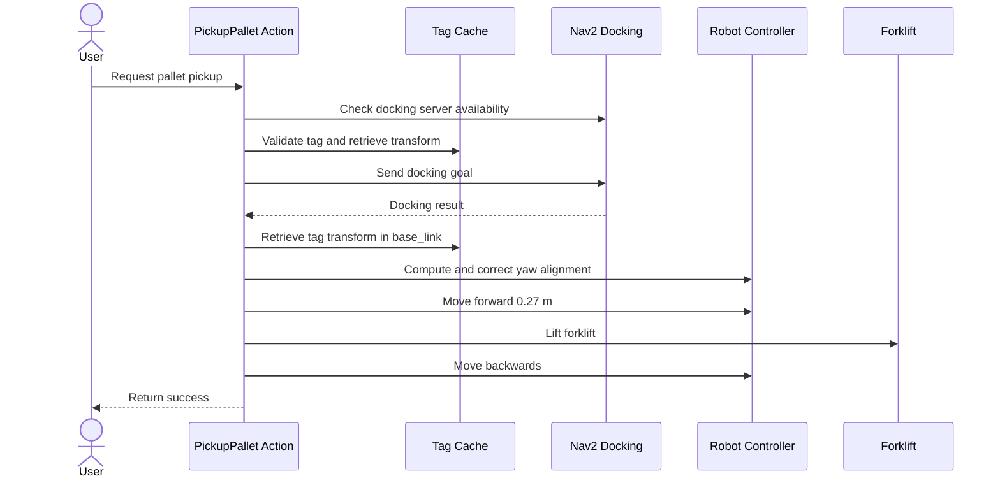

# Pallet Pickup

This package handles all actions involved with detecting pallets using april tags, choosing pallet to grab, docking with pallet, grabbing with forklift.

Exposes:
- **/pickup_pallet** (*Action*) (type: custom_interfaces/action/PickupPallet)
- **/select_tag** (*Service*) (type: custom_interfaces/srv/SelectTag)   

## */pickup_pallet* usage

This action requires one input argument: tag ID (int). If the apriltag with that ID is currently visible, the robot will attempt picking up the package with its forklift. The action ends after the forklift has been raised and the robot has backed up by a pre-determined distance.

The pickup sequence consists of 7 stages:
1. Assert dependencies are available (i.e. DockingServer)
2. Validate tag ID and check if location is tag available (tag is detected by camera)
3. Forward docking request to nav2 DockingServer to approach
4. Fine tune yaw alignment
5. Move forward to place forklift underneath pallet
6. Raise Forklift and move backwards by some distance
7. Assert package has been picked up via lidar

If any of these stages encounters a fatal error, the action is aborted.

### Complete sequence diagram:

 

## */select_tag* usage

This service selects a tag ID among all the currently visible tag IDs. For example, if the camera detects tag with IDs: 3, 5, 6 , this service selects one of them and returns it to the caller.  
The selection policy can be arbitrarily complex, but the default for now is just a random choice.

### Why this service
If a robot is in front of multiple pallets that take care, in order to perform pickup, one of them has to be selected. This service is used to select among all the available pickup candidates.

 

## Integration in BT orchestrator

In a top level orchestrator, the indented flow is something like this:
1. Navigate to pickup location
2. Call */select_tag* to choose a pallet tag ID among the visible pallets, if any
3. Store and process the ID (i.e. derive dropoff zone)
4. Call */pickup_pallet* with the stored ID
5. Pickup done!